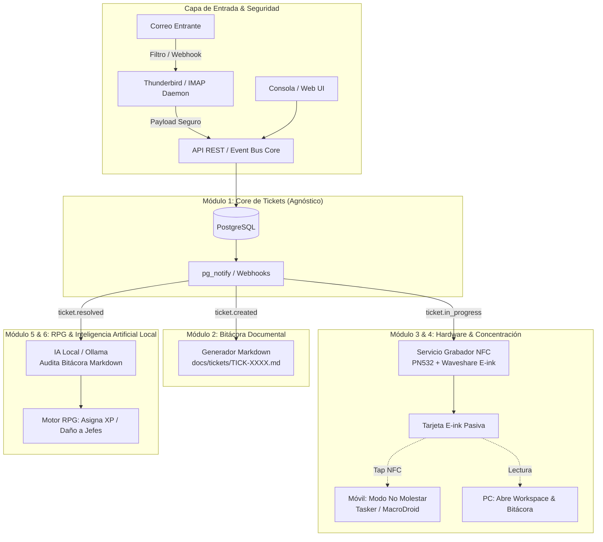

# Especificación de Arquitectura: Sistema Modular de Tickets Ciberfísico, Documental y Gamificado

> **Estado del documento:** Borrador de Arquitectura Inicial  
> **Fecha:** 2026-10-19  
> **Filosofía:** Modularidad estricta, privacidad local (*Local-First*), desacoplamiento de capas y trazabilidad.

---

## 1. Visión General del Proyecto

El objetivo es construir un ecosistema de productividad y gestión de tareas que integre:
1. **Gestor de Tickets Empresarial:** Un sistema formal, cuantitativo y auditable para el registro de tareas y pendientes.
2. **Bitácora Documental en Markdown:** Documentación técnica y cualitativa del procedimiento de resolución de cada ticket (post-mortem/runbook).
3. **Dispositivo Físico de Concentración:** Tarjetas de tinta electrónica (*E-ink*) sin pilas alimentadas por inducción NFC (**Waveshare Passive NFC-Powered e-Paper**) para materializar el ticket en el escritorio.
4. **Orquestador de Contexto y Enfoque:** Al leer la tarjeta con el teléfono, se activa el modo "No Molestar" (permitiendo solo llamadas prioritarias) y la PC prepara el entorno de trabajo específico.
5. **Motor de Gamificación (RPG) & IA Local:** Los tickets resueltos otorgan experiencia y progreso a un avatar virtual, con una IA local (Ollama) evaluando la calidad de la bitácora o generando misiones/jefes basados en la carga de trabajo.

---

## 2. Decisiones de Diseño y Resolución de Dudas Técnicas

Durante la fase de conceptualización se resolvieron dilemas estructurales clave:

### A. Base de Datos Relacional vs. Markdown como Base de Datos
* **Duda planteada:** ¿Se puede usar Markdown directamente como la base de datos de tareas?
* **Resolución técnica:** **No como base de datos transaccional.** 
  * Se utiliza **PostgreSQL** para los datos cuantitativos (IDs secuenciales garantizados, métricas de tiempo, estados, auditoría, integridad referencial y eventos `LISTEN/NOTIFY`).
  * Se utiliza **Markdown** para la **bitácora humana** (código ejecutado, enlaces, notas de investigación y resolución). Un ticket referencia a un archivo Markdown, pero la integridad transaccional reside en la base de datos.

### B. Evitar la "Super-Tabla" (*God Table*) y Desacoplar el Juego
* **Duda planteada:** La tabla principal de tickets contenía demasiados campos mezclados (métricas, fuentes de correo, puntos de juego, etc.).
* **Resolución técnica:** Normalización completa en entidades independientes. El núcleo de tickets (`tickets`) es 100% agnóstico; no contiene datos del juego RPG ni del hardware. Los módulos externos consumen eventos o se vinculan mediante tablas relacionales secundarias.

### C. Seguridad de Credenciales en la Ingesta de Correo
* **Duda planteada:** Conectar un demonio IMAP que guarde contraseñas de correos personales o corporativos en texto plano es un riesgo de seguridad crítico.
* **Resolución técnica:** Se definieron tres estrategias seguras:
  1. **Enfoque Cero Credenciales (Thunderbird Webhook Local):** Thunderbird gestiona la sesión segura. Un filtro interno ejecuta un `curl` local a la API del gestor de tickets cuando coincide el remitente o asunto. El script local no almacena ninguna credencial ni se conecta a internet.
  2. **OAuth 2.0 (XOAUTH2):** Si se usa demonio independiente, se utilizan tokens de solo lectura revocables con un clic desde el proveedor de correo (Google Workspace / Microsoft 365).
  3. **Llavero Cifrado del SO:** Uso de la API Secret Service / Keyring de Linux (`libsecret`, GNOME Keyring, KWallet) para evitar guardar claves en archivos de texto.

---

## 3. Diagrama General de Arquitectura Modular



---

## 4. Desglose Detallado de Módulos

### Módulo 1: Gestor de Tickets (Core Transaccional)
* **Responsabilidad:** Gestionar el ciclo de vida de los tickets de forma agnóstica a cualquier empresa o caso de uso.
* **Componentes:**
  * **API REST:** FastAPI (Python) o Go con endpoints CRUD (`/tickets`, `/queues`, `/work-logs`).
  * **Motor de Base de Datos:** PostgreSQL con soporte `LISTEN/NOTIFY` para publicación de eventos a microservicios.

#### Esquema de Base de Datos Normalizado (PostgreSQL)

```sql
-- 1. Catálogo de Colas / Áreas
CREATE TABLE ticket_queues (
    id SERIAL PRIMARY KEY,
    slug VARCHAR(50) UNIQUE NOT NULL,      -- 'dev', 'infra', 'personal'
    name VARCHAR(100) NOT NULL,
    description TEXT,
    is_active BOOLEAN DEFAULT TRUE
);

-- 2. Catálogo de Estados
CREATE TABLE ticket_statuses (
    id SERIAL PRIMARY KEY,
    name VARCHAR(50) UNIQUE NOT NULL,      -- 'NEW', 'IN_PROGRESS', 'RESOLVED', 'CLOSED'
    is_closed BOOLEAN DEFAULT FALSE,
    sort_order INT DEFAULT 0
);

-- 3. Catálogo de Prioridades
CREATE TABLE ticket_priorities (
    id SERIAL PRIMARY KEY,
    name VARCHAR(30) UNIQUE NOT NULL,      -- 'LOW', 'MEDIUM', 'HIGH', 'CRITICAL'
    weight INT NOT NULL DEFAULT 1
);

-- 4. Entidad Base: Tickets
CREATE TABLE tickets (
    id BIGSERIAL PRIMARY KEY,
    ticket_code VARCHAR(30) UNIQUE NOT NULL, -- ej: "SYS-0042"
    title VARCHAR(255) NOT NULL,
    description TEXT NOT NULL,
    queue_id INT NOT NULL REFERENCES ticket_queues(id),
    status_id INT NOT NULL REFERENCES ticket_statuses(id),
    priority_id INT NOT NULL REFERENCES ticket_priorities(id),
    estimated_points INT DEFAULT 1,         -- Nivel de esfuerzo / Dificultad (1-5)
    created_at TIMESTAMP WITH TIME ZONE DEFAULT NOW(),
    updated_at TIMESTAMP WITH TIME ZONE DEFAULT NOW()
);

-- 5. Submódulo de Origen (Aislamiento de la procedencia)
CREATE TABLE ticket_sources (
    id BIGSERIAL PRIMARY KEY,
    ticket_id BIGINT UNIQUE NOT NULL REFERENCES tickets(id) ON DELETE CASCADE,
    channel VARCHAR(30) NOT NULL,          -- 'EMAIL', 'CLI', 'WEB_UI', 'API'
    sender_email VARCHAR(255),
    message_id VARCHAR(255),               -- RFC Message-ID del header del correo
    raw_headers JSONB,
    created_at TIMESTAMP WITH TIME ZONE DEFAULT NOW()
);

-- 6. Submódulo de Tiempos y Cuantificación
CREATE TABLE ticket_work_logs (
    id BIGSERIAL PRIMARY KEY,
    ticket_id BIGINT NOT NULL REFERENCES tickets(id) ON DELETE CASCADE,
    started_at TIMESTAMP WITH TIME ZONE NOT NULL,
    ended_at TIMESTAMP WITH TIME ZONE,
    duration_minutes INT GENERATED ALWAYS AS (
        EXTRACT(EPOCH FROM (ended_at - started_at)) / 60
    ) STORED,
    notes TEXT
);

-- 7. Submódulo de Documentos y Bitácora
CREATE TABLE ticket_documents (
    id BIGSERIAL PRIMARY KEY,
    ticket_id BIGINT NOT NULL REFERENCES tickets(id) ON DELETE CASCADE,
    doc_type VARCHAR(50) NOT NULL,         -- 'MARKDOWN_BITACORA', 'LOG_FILE', 'EXTERNAL_URL'
    uri VARCHAR(1000) NOT NULL,            -- ej: "file:///docs/tickets/SYS-0042.md"
    sync_status VARCHAR(30) DEFAULT 'SYNCED',
    created_at TIMESTAMP WITH TIME ZONE DEFAULT NOW()
);

-- 8. Trazabilidad e Historial Inmutable
CREATE TABLE ticket_audit_log (
    id BIGSERIAL PRIMARY KEY,
    ticket_id BIGINT NOT NULL REFERENCES tickets(id) ON DELETE CASCADE,
    action VARCHAR(50) NOT NULL,           -- 'CREATED', 'STATUS_CHANGED', 'TIME_LOGGED'
    old_value JSONB,
    new_value JSONB,
    actor VARCHAR(100) DEFAULT 'system',
    created_at TIMESTAMP WITH TIME ZONE DEFAULT NOW()
);

CREATE INDEX idx_tickets_status ON tickets(status_id);
CREATE INDEX idx_tickets_code ON tickets(ticket_code);
```

---

### Módulo 2: Ingestor de Correo Inteligente y Seguro (Submódulo de Entrada)
* **Capa 1 (Filtro Determinista / Autómata):**
  * Evalúa remitentes confiables, prefijos en asunto (ej. `[TASK]`) o carpetas dedicadas.
  * Privacidad total: se puede implementar vía Thunderbird Message Filters disparando un webhook a `localhost`, eliminando el almacenamiento de credenciales en scripts.
* **Capa 2 (Parser IA Local - Opcional):**
  * Un modelo pequeño local (vía Ollama: Llama 3.2 3B o Qwen 2.5 7B) analiza el cuerpo para estructurar el título, resumen y prioridad sin enviar datos a la nube.

---

### Módulo 3: Generador de Bitácoras en Markdown
* Escucha el evento `ticket.created` y crea automáticamente la plantilla de documentación:
  ```markdown
  ---
  ticket_code: SYS-0042
  title: Reparar fallo en despliegue de base de datos
  queue: infra
  priority: HIGH
  created_at: 2026-10-19T23:00:00Z
  status: IN_PROGRESS
  ---

  # SYS-0042: Reparar fallo en despliegue de base de datos

  ## 1. Descripción del Problema
  ...

  ## 2. Investigación y Pasos Ejecutados
  <!-- Documenta comandos, salidas de log y pruebas -->
  ```bash
  journalctl -u postgresql -n 50
  ```

  ## 3. Causa Raíz
  ...

  ## 4. Solución Aplicada & Verificación
  ...
  ```

---

### Módulo 4: Driver de Hardware (Waveshare Passive NFC-Powered e-Paper)
* **Hardware:** Pantalla Waveshare e-Paper pasiva (sin pilas, 2.13", 2.9" o 4.2") + Lector/Escritor NFC (PN532 o ST25DV vía Raspberry Pi, ESP32 o USB).
* **Función:** 
  1. Genera un mapa de bits (1-bit monocromático) con el resumen del ticket, QR/código de barras, estimación y título.
  2. Al colocar la tarjeta en el lector, la energía RF transmite los datos y refresca la pantalla e-ink. La imagen queda fija indefinidamente sin consumir batería.

---

### Módulo 5: Orquestador de Concentración y Contexto (Focus Engine)
* **Disparador Físico:** La tarjeta NFC almacena una URI estándar (ej. `focus://ticket/SYS-0042`).
* **En el Móvil (Android Tasker / MacroDroid / iOS Shortcuts):**
  * Al escanear la tarjeta, el teléfono activa el modo "No Molestar", bloqueando redes sociales y distracciones, pero manteniendo lista blanca para llamadas telefónicas prioritarias.
* **En la PC:**
  * Un script daemon detecta la activación del ticket y abre el espacio de trabajo: carga el archivo Markdown de la bitácora en el editor y abre la consola o terminal del proyecto.

---

### Módulo 6: IA Local Auditora & Motor RPG
* **Auditoría de Calidad:** Al marcar el ticket como `RESOLVED`, Ollama lee la bitácora Markdown generada. Evalúa si la solución está bien documentada y asigna un multiplicador de experiencia.
* **Dungeon Master de Productividad:** La IA analiza la acumulación de tickets pendientes y formula "misiones de incursión" o "jefes" cuya barra de vida representa el esfuerzo combinado de los tickets de la semana.
* **Progresión RPG:** Microservicio independiente que actualiza las estadísticas de un personaje virtual (nivel, clases, inventario) en función de los tickets completados.

---

## 5. Próximos Pasos de Implementación

1. **Paso 1:** Desplegar el esquema de base de datos en PostgreSQL e implementar la API mínima de tickets en FastAPI.
2. **Paso 2:** Configurar el canal de ingesta de correo (mediante webhook seguro de Thunderbird o IMAP local con token en keyring).
3. **Paso 3:** Desarrollar el generador automático de notas de bitácora en Markdown.
4. **Paso 4:** Prototipar la renderización de imágenes de ticket y la grabación en la tarjeta Waveshare NFC con un script en Python.
5. **Paso 5:** Conectar las automatizaciones de concentración en el móvil y la capa RPG con Ollama.
